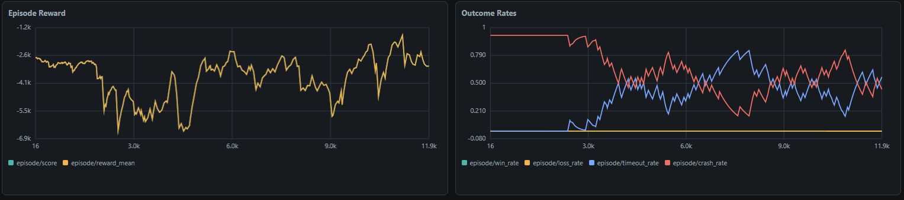
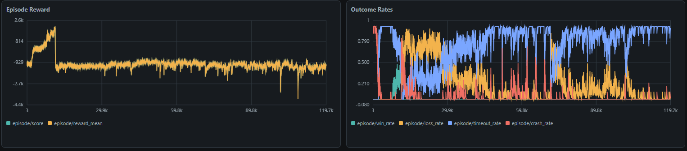
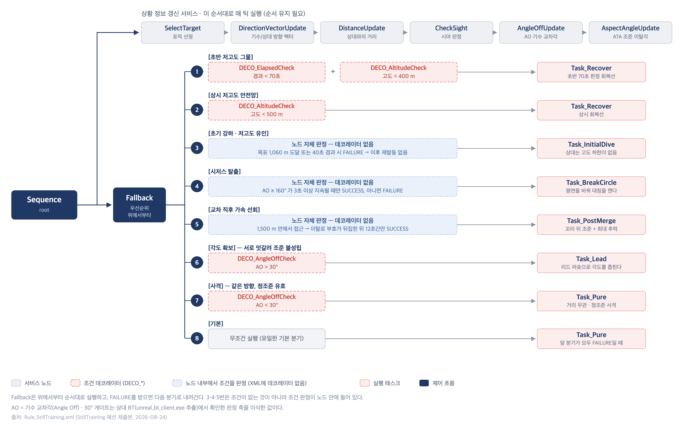
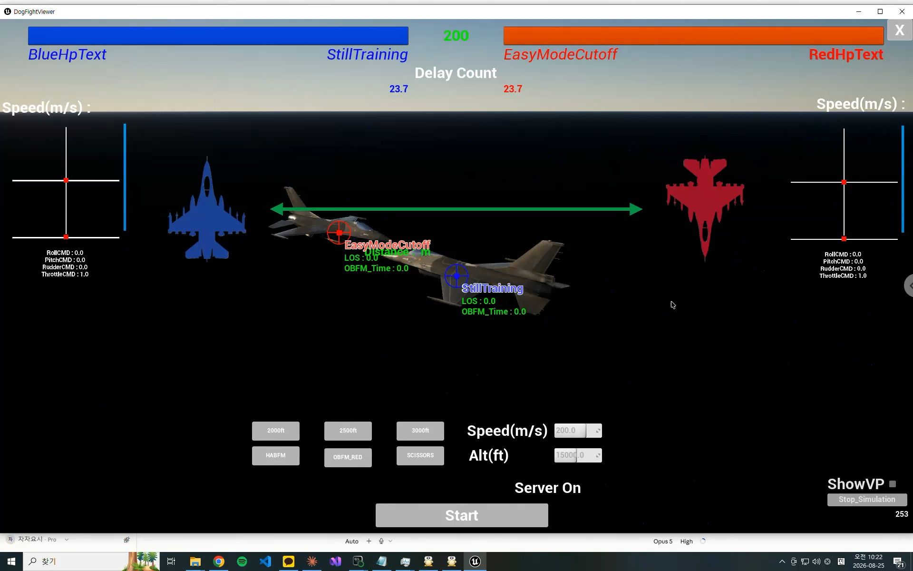
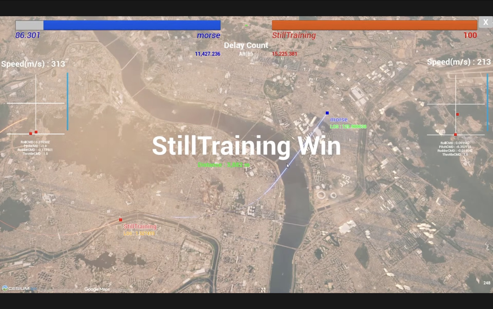
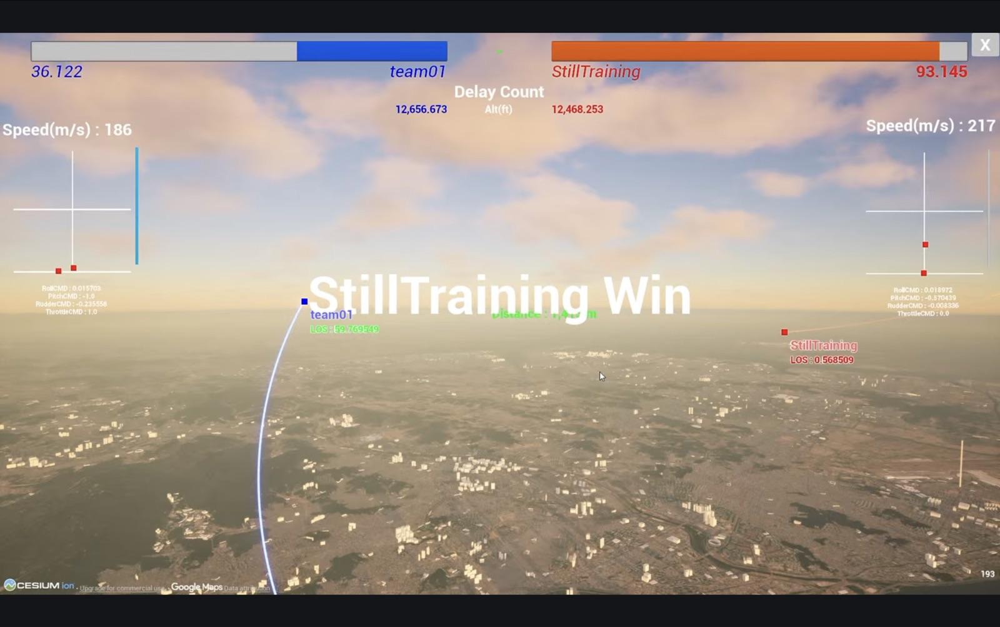
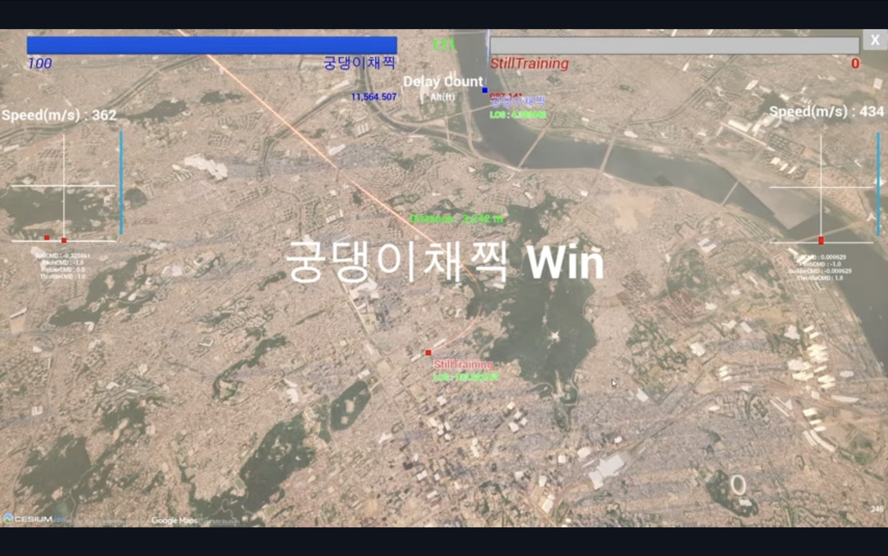
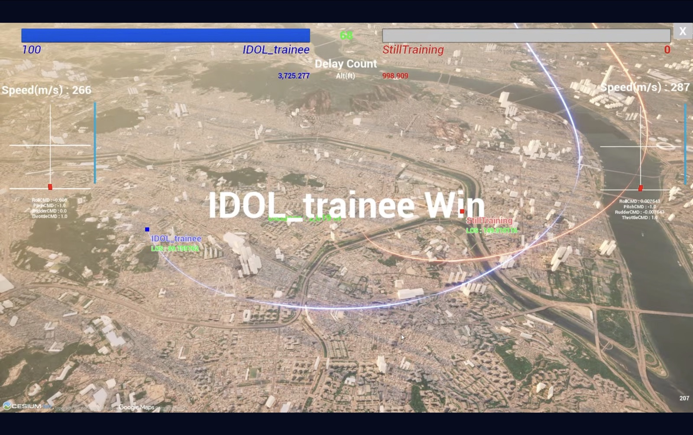
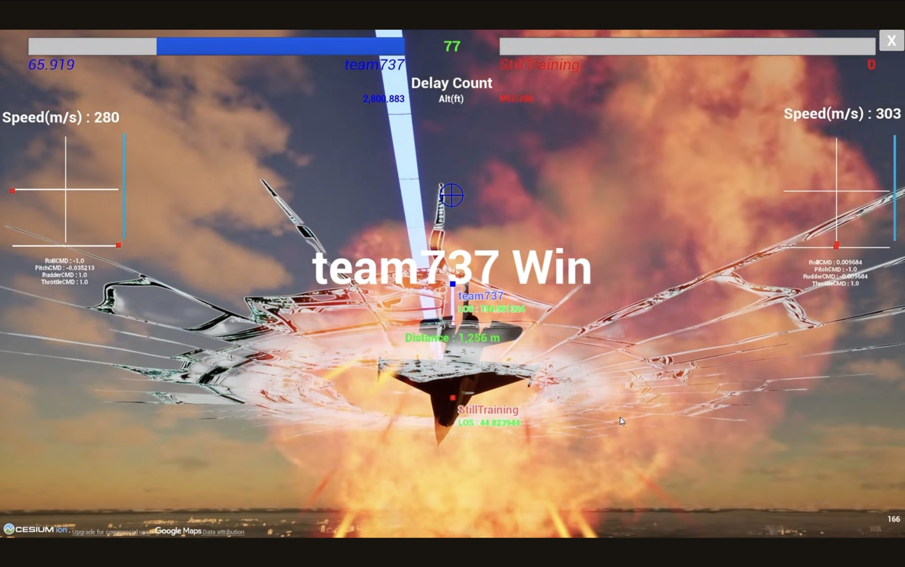

# 2026 AI Pilot Top Gun Challenge — 예선 개발 연구 정리

> **규칙 기반 공중전 에이전트의 설계·검증과 강화학습 접근의 한계 분석**
>
> - 팀: **StillTraining** / 백승헌
> - 제출본 기준일: 2026-08-24 · 제출 코드 `AIP_DCS.dll` / [`Rule_StillTraining.xml`](../behavior-tree/Rule_StillTraining.xml) 기준
> - 원본: 예선 연구 정리 발표자료 (33장)
>
> [← README로 돌아가기](../README.md)

---

## 한눈에 보기

| 항목 | 내용 |
|---|---|
| 과제 | JSBSim F-16 기총 전용 1:1 공중전 에이전트 (200초, 60 Hz UDP) |
| 접근 | 강화학습(SAC+LSTM)과 규칙 기반(Behavior Tree, C++) 두 트랙 병행 → **규칙 기반 제출** |
| 강화학습 | 25개 실험 계열, 442,501 iteration. Stage 1(저기동 표적) 승률 0.80, Stage 2 이후 승률 0.000 |
| 규칙 기반 | 태스크 6종·조건 2종 자체 설계, 제어기 결함 2건 + 조준 결함 1건 수정 → 기동 성능 상대와 대등 |
| 핵심 전략 | 상대 BT에 절대 고도 하한·회복 기동이 없음을 분석 → **저고도 유인 전략** |
| 내부 시험 | Cutoff 에이전트 상대 9전 8승 1무 0패 (적기 추락 5회) |
| 예선 본경기 | **5전 2승 3패, 본선 진출 실패** — 패배 3경기 모두 자기 기체 추락 |
| 교훈 | “지금 쫓아도 되는가(생존)”를 판정하는 규칙 부재. 안전은 보상이 아닌 제약으로 분리해야 함 |

---

## 1. 서론

### 1.1 과제 정의 및 교전 규칙 (공식 규정집 v1.4)

| 항목 | 내용 |
|---|---|
| 교전 시간 | 200초 |
| 무장 | 기총 전용 (초근접 교전) |
| 유효 사거리 (WEZ) | 152 ~ 914 m |
| 추락 판정 | 고도 약 300 m 이하 |
| 통신 | 60 Hz UDP · 위치/자세/속도 수신, Roll·Pitch·Yaw·Throttle 반환 |

**승리 조건 (규정 제6조)**: 상대 격추(HP 0) / 상대 추락(고도 약 300 m 이하) / 상대 응답 불능(1회 경고, 2회 승리) / 시간 만료 시 잔여 HP 비율 우위

**대미지 판정 — 경과 시간 3단계**

| Phase | 경과 시간 | LOS | 판정 거리 | 계수 |
|---|---|---|---|---|
| 1 | 0 – 100 s | < 1° | 500 – 3000 ft | 1 |
| 2 | 100 – 150 s | < 2° | 500 – 3500 ft | 0.3 |
| 3 | 150 – 200 s | < 3° | 500 – 4000 ft | 0.1 |

하위 Phase 범위에 적기가 있으면 하위 Phase 계수를 적용. 시간이 갈수록 조준각은 넓어지지만 계수는 낮아진다.

**설계상 함의**
- 초반 100초 명중은 계수 1.0 → 조기 우위 확보가 유리
- 추락선 300 m(로그 실측 305 m) → 저고도는 무기이자 위험 요소
- 응답 불능은 패배 사유 → 60 Hz 주기(16.7 ms) 안에서 연산 완료 필요

### 1.2 개발 환경 및 제공 범위

| 구분 | 대회 제공 | 본 팀 스택 |
|---|---|---|
| 규칙 기반 (제출) | BT 개발환경: DLL + XML (C++) | C++ / BehaviorTree.CPP / Visual Studio 2022 |
| 강화학습 | 학습환경: CheckPoint (Python) | Python / Ray RLlib / PyTorch (SAC + LSTM) |
| 가시화 | 교전 뷰어 (DogFightViewer) | — |

**제공 노드 vs 자체 설계 노드** — 배포본 `AIP_LIB.zip`에는 기동 노드가 사실상 없었다.

| 구분 | 대회 배포본 | 본 팀 최종 트리 |
|---|---|---|
| Task (기동) | `Task_Empty` 1종 | **6종 자체 설계** |
| Decorator (조건) | AngleOff · BFM · Distance · LOS | 3종 (AngleOff 외 2종 자체) |
| Service (상태) | 6종 | 6종 그대로 사용 |

배포 제어기 `Controller_CY.cpp` 수정은 **3행**뿐이며 나머지는 원본 유지 (4.3~4.5절).

---

## 2. 접근 전략 — 두 트랙 병행과 전환 판단

| 날짜 | 트랙 | 내용 |
|---|---|---|
| 07.23 | 규칙 기반 | BT 초기 트리 (거리 기준 3분할: 접근 / 선회전 / 사격) |
| 07.27 | 강화학습 | 커리큘럼 없이 SAC+LSTM 단일 학습 — 50회 반복에 추락률 100%, 승률 0 |
| 07.27~ | 강화학습 | 난이도 6단계 커리큘럼 구조로 전면 재설계 |
| 08.03 | 규칙 기반 | 조종 명령 생성기 결함 2건 발견·수정 — 기동 성능 회복 |
| 08.08~19 | 강화학습 | 보상 결함 진단 및 함수 형태 수정 — Stage 1 승률 0.80 |
| 08.19 | 강화학습 | Stage 2 이후 30,000 iteration 완주 후 승률 0.000 — 한계 확인 |
| 08.24 | 규칙 기반 | 상대 BT 판정 축 이식, 저고도 유인 전략 도입, 최종 제출 |

**전환 근거**: 동일 상대·동일 조건 로컬 교전에서 규칙 기반 BT는 단독으로 대미지 0.786을 기록한 반면, 강화학습 모델 3종은 모두 적 체력 1.000(명중 0). 잔여 기간을 고려해 규칙 기반으로 확정.

---

## 3. 강화학습

### 3.1 정책 네트워크 — MLP vs SAC+LSTM

Stage 0(기초비행) 동일 조건 비교 (`control_zone16` 관측, SAC): MLP 4,461회 vs **LSTM 4,222회**로 승급.
- LSTM이 승급 조건을 약 200회 앞서 통과
- 공중전은 상대 움직임 이력이 판단에 직접 기여 → 순환 구조 채택
- 연속 행동 공간(4축, 각 −1~+1)과 표본 효율을 고려해 off-policy **SAC** 사용

### 3.2 관측 설계 — 3차 개정 (cz16 → cz18 → cz15)

| # | 필드 | 의미 | cz16 | cz18 | cz15 |
|---|---|---|:-:|:-:|:-:|
| 0–4 | roll, pitch, speed, alt, aoa | 자기 상태 | ● | ● | ● |
| 5–7 | roll/pitch/yaw rate | 각속도 | ● | ● | ✕ |
| 8–13 | distance, ata, aa, target_ata, target_aa, los_el | 상대 기하 | ● | ● | ● |
| 14–15 | own_wez_in, target_wez_in | WEZ 여부 | ● | ● | ● |
| 16–17 | closure_rate, speed_delta | 시간 변화량 | ✕ | ● | ● |

- **1차 (cz16→cz18)**: 표적을 74~300 m로 스쳐 지나가 수 km 밖으로 이탈. “거리”는 있으나 “얼마나 빨리 가까워지는가”가 없어 감속 시점 판단 불가 → `closure_rate`, `speed_delta` 추가
- **2차 (cz18→cz15)**: 제출 프로토콜은 위치·자세·속도 9개만 제공(각속도 없음) → 각속도 3개 제거. 학습·제출 관측 차원을 미리 일치시킴

### 3.3 커리큘럼 설계 (최종 7단계, 실측 배치 기준)

| # | 이름 | 표적 | 시간 | 예산 | 진급 조건 |
|---|---|---|---|---|---|
| 0 | flight_basics | loiter (뱅크 0) | 60s | 10,000 | 추락률 ≤5%, 저고도 페널티 스텝 ≤5 |
| 1 | loiter_pursuit | loiter | 150s | 30,000 | 추락 ≤10%, 최소거리 152~500m, 평균거리 ≤2,000m, WEZ ≥50스텝, 승률 ≥0.80 |
| 2 | merge_loiter | loiter (비사격) | 200s | 30,000 | 추락 ≤10%, WEZ ≥30스텝, 승률 ≥0.50 |
| 3 | abreast_2500 | 실전 BT | 200s | 30,000 | 추락 ≤15%, WEZ ≥30스텝 |
| 4 | abreast_mixed | 실전 BT | 200s | 30,000 | 동일 |
| 5 | habfm | 실전 BT | 200s | 30,000 | 동일 |
| 6 | headon_full | 실전 BT 혼합 | 200s | 30,000 | 최종 단계 |

재설계 요점:
- Stage 0 표적 fixed → loiter: fixed 표적이 초당 115.8 m 하강해 학습 신호 왜곡
- Stage 2 `merge_loiter`(비사격) 신설: 108,000 iteration 동안 적 체력이 줄지 않아 교차 기동만 분리 학습
- Stage 3 이후 실제 서버 배치 두 종류(1~3R abreast 761 m / 4R+ HABFM 5,537 m)에 맞춤

### 3.4 커리큘럼 수정 이력

| 시점 | 계기 | 조치 |
|---|---|---|
| 07.27 | 단일 학습 → 추락률 100%, 승률 0 | 커리큘럼 도입 |
| 08.05 | 난이도 사다리 필요 | 1세대 자작 7단계 (flight_basics → tail_lock ×5 → bt_dogfight) |
| 08.09 | 정책이 정확히 1,200 m 경계에 정지 | 접근 cutoff 1,200 → 600 m |
| 08.10 | 거리를 안 좁히고도 진급 조건 통과 | 평균거리 ≤3,000 m, 포화율 ≤0.30 추가 |
| 08.10 | 헤딩 ±90° 회복 선회가 이탈 조건에 절단 | 헤딩 ±45°, 이탈 8 → 12 km |
| 08.12 | 60° 뱅크 선회반경 5,297 m → 최대 이격 21,187 m | 이탈 거리 8,000 → 20,000 m |
| 08.13 | Stage 1이 승률 0.048로 통과 중 | 승률 ≥0.80, 최소거리 152~500 m 신설 |
| 08.14 | 대회측 세밀한 커리큘럼 발견 | 2세대: AlphaDogFight two_circle_headon 도입 + 개조 5건 |
| 08.14 | 실서버 배치가 두 종류뿐 | 3세대: 실측 배치로 재구성 |
| 08.14 | fixed 표적 하강으로 에피소드 끊김 | Stage 0 표적 → loiter |
| 08.14 | 전반 100초 ATA 1° 채점은 신호 희박 | Phase 판정은 최종 단계에서만 적용 |
| 08.19 | 108k iteration 적 체력 0.99~1.00 (피격사는 73→3% 개선) | Stage 2 merge_loiter 신설 + 번호 재편 |

### 3.5 보상 설계 방법 — “계수가 아니라 함수 형태를 수정”

보상을 사전 확정하지 않고, 이상 행동 시 해당 행동의 보상 기울기를 직접 계산해 수정했다.

**사례 — 조준을 포기하고 표적을 관통** (900 m · ATA 5° 지점)

| 선택 | 보상 기울기 |
|---|---|
| 조준 개선 | +0.180 |
| 거리 단축 | +0.213 |
| 비율 | 0.845 → 돌진이 이득 |

- `r = w · f(조준) · g(거리)` 구조에서 가중치 w는 두 기울기 비율에서 **약분**된다 → w를 8배로 올려도 0.845 불변
- 지수는 한쪽 항에만 남는다: `d(fⁿ)/df = n·fⁿ⁻¹` → `wez_approach_angle_power` 2 → 4
- 비율 예측 1.69, 실측 1.86 → 조준이 이득

| 지표 | 수정 전 | 수정 후 |
|---|---|---|
| 조준 오차 ATA | 50° | 3° |
| WEZ 체류 | 6.2 스텝 | 208.2 스텝 |
| 추락률 | 48% | 2% |

### 3.6 보상 정규화와 스케일

- **항별 무차원화 (적용)**: 각 원시량(°, m, kt)을 기준값(`half_angle 30°`, `pursuit_range 3,000 m`, `floor 400 m`, `cap 100 kt`)으로 나눠 [0,1]로 만든 뒤 가중치를 곱함
- **누적 스케일 정합 (미적용)**: 스텝 보상은 18,000스텝 누적(최대 36,000), 종료 보상은 1회(win 100, 체력차 ×500). 상대 크기를 사전 비교하지 않아 결함 3건 발생

| 시점 | 증상 | 조치 |
|---|---|---|
| 08.12 | 접근 보상 에피소드 합계 −4,716 | 항 제거 |
| 08.14 | 무승부가 200초 교전보다 유리 | guard_fail −300 |
| 08.19 | 이탈 종료 도주로 +115점 | disengage −300 |

### 3.7 최종 보상 함수 구성

| 그룹 | 주요 항목 (기본 / 머지) | 역할 |
|---|---|---|
| 거리 유인 | `w_relative_position` 2.0 / 3.0, `w_speed_advantage` 0.4 | cos(aa) × 근접도 주력, 초과속도로 동속 정체 해소 |
| 조준 유인 | `w_wez_approach` 1.5, angle_power 4.0, `w_gunsnap_own` 3.0 / 10.0, `w_gunsnap_target` 0 / 10.0 | 조준 × 거리, 정조준 근방 기울기 강화 |
| 벌점·안전 | `w_too_close` 3.0 (152.4 m), `w_flight_limit` 2.0 | 데미지 0 구간 침투·비행 한계 이탈 벌점 |
| 종료 보상 | `w_damage_diff` 500, win/loss ±100, disengage·guard_fail −300 (머지) | 체력차 보상, 도주·조기종료 차단 |

머지 단계(정면 교차)는 조준항 각도 모드를 cosine으로 바꾸고, 상대가 나를 겨눈 상태에 벌점을 신설했다.

### 3.8 보상 결함의 세 유형

> 세 유형 모두 “정책이 잘못 학습한 것”이 아니라 **“보상 함수가 그렇게 시킨 것”**

| 유형 | 증상 | 정책 입장의 최적해 |
|---|---|---|
| ① 보상이 끊기는 경계 생성 | 특정 지점에 고착 | 경계선 위에서 점수만 수확 |
| ② 원하는 행동의 부호 반전 | 가르치려는 행동 회피 | 그 행동을 하지 않음 |
| ③ 값·기울기가 0인 구간 | 학습 정체 | 신호 없이 임의 행동 |

| 시점 · 런 | 유형 | 원인 → 관측 행동 | 조치 |
|---|---|---|---|
| 08.09 cz18_close_v2 | ① | 접근 보상 1,200 m 안쪽만 인정 → 1,200 m 선에서 정지 | cutoff → 600 m |
| 08.11 angle_v4 | ③ | 거리 감쇠 지수함수 → 원거리 방향 신호 소멸 | exp → 1/(1+d/r) |
| 08.12 angle_v6 | ② | 접근 보상이 순 페널티(−4,716) → 속도 300→181 m/s 정지 수렴 | w_closure 2.0 → 0 |
| 08.13 aim_p4_v1 | — | 가중치 공통 곱 → 조준 포기, 3 m 관통 | 조준항 지수 2 → 4 |
| 08.14 alpha_curriculum | ③ | 조준항이 45° 초과에서 0 → 정면 머지 학습 불가 | angle_mode → cosine |
| 08.14 alpha_curriculum | ② | 무승부(−30)가 교전보다 유리 → 조기 종료 | guard_fail 인하 |
| 08.19 i5_merge_v1 | ② | 이탈도 무승부 처리 → 교차 후 수직 상승 도주(+115) | disengage −300 |
| 08.19 i5_merge_v1 | ② | cos(aa)가 적기 앞쪽에서 음수 → 머지 회피 | w_relative_position 3.0 → 2.0 |

### 3.9–3.10 학습 결과와 한계

총 **25개 실험 계열, 442,501 iteration**.


*그림 1. tail_close_v1 (11.9k iter) — 승률(청)과 추락률(적)이 3k 부근에서 교차 후 정체*


*그림 2. 최종 보상 설계 (119.7k iter) — 무승부(황)와 타임아웃(청)이 지배적*

- **도달 지점**: Stage 0~1 성공 — 승률 0.80, WEZ 체류 135스텝, 최소거리 2,008 → 452 m. 정지·저기동 표적은 강화학습으로 해결 가능
- **한계**: Stage 2 이후 두 접근 모두 30,000 iteration 후 승률 0.000
  - 실전 BT 상대: 추락은 해결, 타임아웃 75% — 교전 회피로 수렴
  - 비사격 표적 재설계: 추락률 92% 상수해 고착 (최소거리 703 m 정지, 보상 −512 불변)

**동일 조건 비교 교전** (상대 AIP_BASE_target · 300초 · 로컬)

| 아군 모델 | 결과 | 적 체력 | 준 데미지 |
|---|---|---|---|
| RL Stage 3 | 타임아웃 생존 | 1.000 | 0.000 |
| RL Stage 4 | 추락 | 1.000 | 0.000 |
| RL Stage 5 (최종) | 격추당함 | 1.000 | 0.000 |
| **규칙 기반 BT** | 격추당함 | **0.214** | **0.786** |

---

## 4. 규칙 기반 에이전트

### 4.1 시스템 구조

```
교전 서버 (DogFightViewer, JSBSim F-16)
  │ 60 Hz UDP
  ▼
수신·좌표 변환 (client.py → CPPBehaviorTree.cpp, LLA → Cartesian)
  ▼
블랙보드 (내/적 위치·자세·속도)
  ▼
서비스 6종: SelectTarget → DirectionVector → Distance → CheckSight → AngleOff → AspectAngle
  ▼
Behavior Tree (Fallback 8분기: 안전 → 전략 → 특수 상황 → 전투 판정 → 기본)
  │ 조준점 VP_Cartesian, Throttle 0~1          ← ① 우리 코드
  ▼
StickController::GetStick() (Controller_CY.cpp)  ← ② 우리 코드
  │ Roll/Pitch/Rudder CMD (−1 ~ +1)
  ▼
JSBSimAIPLib.dll::RunFighter (폐쇄 바이너리)
  ▼
F-16 FCS (rate · load factor command) → 공력 빌드업 → 6DOF 적분 → 기체 상태
  └──── 외측 피드백: 다음 프레임 패킷 ────┘
```

대역폭이 다른 두 폐루프(우리 60 Hz outer loop + FCS 내측 loop)가 중첩된 구조. 스로틀은 태스크가 직접 기록하며 제어기를 거치지 않는다.

### 4.2 비행제어(FCS) 내부 — 3채널

stick 명령은 조종면 편각이 아니라 **rate · load factor command** (fly-by-wire).

| 채널 | 명령 | 피드백 | PID (kp / ki / kd) | Actuator | 최대 편각 |
|---|---|---|---|---|---|
| Roll | Roll rate | p × 0.318 | 3.0 / 0.0005 / −0.00125 | 0.3 s | Aileron ±21.5° (M1.0에서 ×0.15 → 약 ±3.2°) |
| Pitch | G + α schedule | q × 6.2, n_z × 0.02 | 0.3 / 0.025 / 0 | 0.3 s | Elevator ±25° (명령단 clip [−1, +0.44]) |
| Yaw | Yaw load | r × schedule, n_y × 0.25 | 0.1055 / 1e−5 / 5e−5 | 0.4 s | Rudder ±30° |

스케줄 게인: 현재 비행 상태(속도·받음각)에 따라 표에서 찾아 곱하는 가변 게인. 위험할수록 명령 반영 비율을 줄여 기체를 보호.

### 4.3 조종 명령 생성기 구조

| 기호 | 정의 | 범위 | 역할 |
|---|---|---|---|
| UTAngle | 양력 벡터(기체 위쪽)와 조준 방향 사이 각 | −180° ~ +180° | 어느 쪽으로 빗나갔나 |
| LOS | 기수와 조준점 사이 각 (공중전 용어로 ATA) | 0° ~ 180° | 얼마나 빗나갔나 |

롤은 UTAngle → 0 (양력 벡터를 표적에 겨눈 뒤 당김 = lift vector control).

```cpp
// Roll : pure P — UTAngle 60°에서 포화
RollCMD = std::sin(UTAngle / 2.0) * 2.0;
RollCMD = clamp(RollCMD, -1, 1) * clamp(LOS, 0, 1);

// Pitch : P + weak I (최근 60틱 LOS 이동평균) — 양력 벡터가 표적을 향할 때만 당김
Roll_Effect = 1 - clamp(|UTAngle| / 90, 0, 1);
PitchCMD    = ERROR_Effect(LOS) * Roll_Effect * (-1);

// Rudder : P + 20-tap moving average
RudderCMD = -std::sin(UTAngle) * clamp(LOS, 0, 6);
```

### 4.4 조종 명령 생성기 결함 분석 및 수정

증상: 교전 시작 직후 상대가 먼저 기울고 그 차이가 끝까지 유지. 스로틀 0.5 → 1.0에도 롤 도달 속도 불변 → 추력이 아니라 명령 계산식 문제.

| 경과 | 우리 | 상대 | 차이 |
|---|---|---|---|
| t = 3s | 60° | 77° | −17° |
| t = 6s | 71° | 79° | −8° |
| t = 8s | 76° | 80° | −4° |

시작 거리별 전적: 913 m 5판 3승 / 609 m 6판 0승.

- **결함 1 — 롤 게인 감소**: `sin(UTAngle)`은 180°에서도 0 → 가장 급히 돌아야 할 때 명령 소멸. `sin(UTAngle/2) × 2.0`으로 단조성 회복
- **결함 2 — 롤 명령 제곱**: `RollCMD *= |RollCMD|` → 0.7→0.49, 0.5→0.25. 배포본의 진동 억제(expo) 의도였으나 최대 선회가 필요한 본 과제와 목적 불일치 → 제거
- **결함 3** (조준 계산, `Task_Lead.cpp`) → 4.6절

### 4.5 수정 효과와 제어 구조상 위치

| 지표 | 우리 | 상대 | 차이 |
|---|---|---|---|
| 선회 반경 | 973 m | 999 m | −26 m |
| 선회율 | 12.2 °/s | 12.2 °/s | 0.0 |
| 평균 뱅크 | 79.8° | 81.1° | −1.3° |
| 종단 비에너지 | 4,607 | 4,634 | −27 |

→ 네 지표 모두 오차 범위 안. **기동 성능만으로는 우위를 만들 수 없다**고 판단해 규칙 기반의 구조적 이점 활용으로 전환 (5장).

- 본 팀 제어기 = cascade의 **outer attitude loop (P 제어, 60 Hz)**, inner rate loop(PID)는 FCS가 담당 → outer를 P로 구성하는 것이 구조상 타당
- 플랜트 권한 한계: Aileron Mach 1.0에서 15%, Elevator α ±30°에서 0%, 기수 내림 명령 +0.44 제한

### 4.6 전술 노드 — 추적 3종

| 노드 | 방식 | 비고 |
|---|---|---|
| `Task_Pure` | 표적 현재 위치 조준, Throttle 1.0 | 대조군(기준선). 각도 기반 감속 시도 → 속도 235→192 m/s, 피격 증가로 철회 |
| `Task_Lag` | 두 선회 중심 차이의 수직 성분으로 조준점을 바깥으로 밀어 오버슛 억제 (kLagGain 0.4) | 최종 트리 미사용 |
| `Task_Lead` | 표적 속도 × leadTime(≤1.5 s)으로 미래 위치 조준 | **결함 3 수정**: 오프셋 각도 상한 3° |

**결함 3**: 접근속도 ≈ 0 + 표적 선회 중이면 leadTime이 1.5초에 고착 → 250 m/s 기준 조준점 375 m 밀림, 500 m 거리에서 **37° 빗나감**. 피격 판정이 ATA 1~3°이므로 오프셋 각도를 3°로 절단(방향·구조는 유지).

### 4.7 전술 노드 — 상황 대응 (1)

**`Task_BreakCircle` — 대칭 시저스 탈출**
- 제어기 수정 후에도 최고 ATA 4.8° 정체. 원인은 대칭 시저스(사거리 안 AO 중앙값 116~125°)
- AO ≥160°가 **3초 이상** 지속 시 발동(헤드온 교차는 1초 미만이라 오발동 없음)
- 조준점을 기체 축 기준(전방 500 + 상방 2000 + 측방 ±800)으로 잡아 지속 최대 선회 → 선회 평면 전환. 발동 후 2.5초 유지

**`Task_PostMerge` — 교차 직후 되돌아서기**
- 접근 → 이탈 전환 + 거리 1,500 m 이내 감지 시 12초 유지 (180° 반전에 11~15초 필요)
- Lead의 스로틀은 적 속도 추종이라 반전 구간에서 가속하지 않음 → 전용 분기 분리
- 정조준 시 롤이 130° → 2°로 풀려 반경 1,629 m로 벌어짐 → 조준점을 **적 꼬리 뒤 0.5 × 거리**에 두어 이탈각 일정 유지(최대 30°)

### 4.8 전술 노드 — 상황 대응 (2)

**`Task_InitialDive` — 초기 강하**
- 교전 시작 직후 적 수평 방위로 **강하각 55°** 급강하, 고도 1,060 m 이하 또는 40초 경과 시 종료(1회만)
- 관성 오버슛 700~732 m로 일정 (종료 속도 335 m/s대 포화) → 실제 바닥 ≈ 목표고도 − 710 m
- 상대는 `DECO_TargetAltDifCheck`로 고도차를 맞추므로 접근과 강하가 동시에 일어남

**`Task_Recover` — 고도 회복**
- 표적 무관, 기수 방위 유지한 채 **45° 상승**, Throttle 1.0
- 상승각 56° → 30° → 45° 조정 (56°는 정점 2,700~3,000 m로 튀어 유인 전략과 충돌, 30°는 회복력 부족)
- 한계: 고정 명령이라 1,200 m 통과 후 소모 고도가 51 / 435 / 892 m(최소/중앙/최대)로 크게 분산. 배면(뱅크 100°↑)에서는 롤을 푸는 데만 8초

### 4.9 조건 노드

| 노드 | 기능 | 출처 |
|---|---|---|
| `DECO_AltitudeCheck` | 절대 고도 하한 판정 (XML 속성으로 임계값, 여러 번 재사용) | 자체 |
| `DECO_ElapsedCheck` | 교전 경과 시간 판정 (국면별 회복선 적용) | 자체 |
| `DECO_AngleOffCheck` | AO 30° 기준 각도 확보 / 사격 분기 | 배포본 |

**AO 30° 게이트 채택 근거**: 종전 트리는 거리 기준(2,000 m 안이면 Lead). 상대 BT(`unreal_bt_client.exe`)를 추출해 보니 거리와 무관하게 AO 30° 하나로 Lead/Pure를 가름. AO가 크면 엇갈려 조준 불성립 → 각도 먼저, 작으면 정조준 유효. (거리 기준 트리와의 승률 비교는 미수행)

### 4.10 Behavior Tree 최종 구성


*그림 5. 최종 Behavior Tree 구조 — `Rule_StillTraining.xml`*

| 구분 | 수 | 비고 |
|---|---|---|
| 서비스 | 6 | 전량 배포본 |
| 조건 | 3 | AngleOff 외 2종 자체 |
| 태스크 | 6 | 전량 자체 설계 |
| 분기 | 8 | Fallback 우선순위 (배치 순서 자체가 설계 결정) |

- InitialDive · BreakCircle · PostMerge 분기는 조건 판정이 노드 내부에 있어, 해당하지 않으면 FAILURE로 다음 분기에 넘김
- **구현 결함(확인)**: 저고도 회복선을 초반 70초/이후 2단으로 설계했으나 두 번째 분기에 시간 조건을 넣지 않아 실제로는 단일 회복선으로 동작. 결과적으로 이 분기가 초기 강하의 풀아웃을 담당

---

## 5. 저고도 유인 전략

### 5.1 상대 Behavior Tree 분석

기동 성능이 대등(선회율 12.2 vs 12.2 °/s)해진 뒤에도 승률이 오르지 않아 **규칙 기반의 구조적 이점** — “고도 N m 이하에서 반드시 회복” 같은 명시적·검증 가능한 하드 규칙 — 을 활용.

| 노드 | 본 팀 | 상대 |
|---|---|---|
| `DECO_AltitudeCheck` (절대 고도) | 있음 | **없음** |
| `Task_Recover` (회복 기동) | 있음 | **없음** |
| `DECO_TargetAltDifCheck` (상대 고도차) | 없음 | 있음 |

상대는 고도차만 보고 따라 내려오며 절대 고도 하한이 없다 (`CollisionAvoidance`는 기체 간 충돌용).

**로그 검증**: 하루치 115판 전수 조사 → 상대가 추락선(305 m) 이하 도달 10판, 그중 3판은 종료 거리 2,764~6,090 m(WEZ 밖)로 **자멸**.

| 교전 (08-24) | 우리 1,000 m 밑 체류 | 적 최저 고도 |
|---|---|---|
| 16:01:57 | 4.1% | 486 m (생존) |
| 16:07:11 | 66.7% | 308 m |
| 16:11:14 | — | 37초에 CFIT |

→ 한 번 깊이 내려가는 것보다 **오래 낮게 머무르는 쪽**이 상대 자멸 확률을 높임. 우리 바닥이 곧 적의 바닥이 되는 경향(312 m vs 308 m).

### 5.2 초기 강하 설계

목표 고도 = 회복 여유가 남는 최저값. 실측 10판 오버슛 700~732 m (편차 32 m).

| 가정 | 예상 바닥 | 추락선 여유 |
|---|---|---|
| 오버슛 732 m (최악) | 328 m | 23 m |
| 오버슛 710 m (중앙) | 350 m | 45 m |

- 목표 고도 **1,060 m** 채택. 검증 3판 강하 바닥 331 / 344 / 361 m, 3판 모두 생존, 1판에서 적기 37초 CFIT
- 더 내리지 않은 이유: 최악 표본 전체 최저 312 m(추락선까지 7 m). 1,045 m 적용 시 313 − 32 = 281 m → 추락
- 저고도 깊이를 정하는 것은 XML 회복선이 아니라 `kTargetAltM`. 1,060 m로 낮춘 뒤 회복선(500 m)을 반드시 통과 → 회복 분기가 풀아웃 담당
- 강하각 55°는 의도적 — 우리가 급할수록 상대도 급해져 지면에 가까워짐

### 5.3 안전장치와 구조적 한계

- 회복 소모 고도 51 / 435 / 892 m (12표본) — 고정 명령이라 진입 조건 차이가 그대로 결과 분산
- 회복선 500 m − 소모 892 m = **−392 m → 추락**. 회복선을 어디에 두든 급강하 판에서는 뚫림
- **개선 방향 (미반영)**: 트리거 = 현재 고도 − 강하율 × 여유시간 (예측형). 비례상수 0.31~1.30초(중앙 0.82초)
- **배면 문제**: 교차 직후 배면으로 뒤집힌 채 최대 풀 → 롤 172° → 0° 해제에 8초, 1,500 m 소모. 피치 채널은 이미 포화(−1.00)라 고도 기준만으로는 회복 여력 증가 불가

---

## 6. 결과

### 6.1 내부 교전 시험 — Cutoff 에이전트 상대 (3라운드 × 3회)

| 최종모델 vs Cutoff | Test 1 | Test 2 | Test 3 |
|---|---|---|---|
| Round 1 (2000 ft) | Win (적기추락) | Win (적기추락) | Win (적기추락) |
| Round 2 (2500 ft) | Win (적기추락) | Win (적기추락) | Win (판정승) |
| Round 3 (3000 ft) | Win (판정승) | Win (판정승) | Draw |

| 구분 | 횟수 | 비율 |
|---|---|---|
| 승 (적기 추락) | 5 | 55.6% |
| 승 (판정승) | 3 | 33.3% |
| 무승부 | 1 | 11.1% |
| 패 | 0 | 0% |

- 9회 중 5회 적기 추락 → 저고도 유인 전략이 의도대로 작동
- 시작 고도가 높을수록(3,000 ft) 유인 효과 감소
- 한계: 노드 단위 기여도 미측정, 상대가 Cutoff 1종뿐


*그림 6. 최종 교전 시험 (DogFightViewer)*

### 6.2 제출 패키지

`StillTraining_예선제출.zip` · 2.70 MB · 77개 파일

| 파일 | 역할 |
|---|---|
| `submit_bt.py` | 실행 진입점 (강화학습 모듈 미참조) |
| `AIP_DCS.dll` | Behavior Tree 엔진 (팀 빌드) |
| `Rule_StillTraining.xml` | 팀 트리 규칙 (파일명 컴파일 시점 고정 — 변경 금지) |
| `src/dogfight/` | 통신 및 공통 모듈 |
| `aircraft/`, `engine/`, `JSBSimAIPLib.dll` | 배포본 동일 |

```bash
cd StillTraining
python submit_bt.py --server-ip <교전서버IP>
```

- 의존성: numpy 2.2.6, gymnasium 1.2.2, pymap3d 3.1.0, filelock 3.18.0 (모두 제공 환경 포함, 추가 설치 없음)
- 통신 성능: BT 연산 **프레임당 17 µs** (60 Hz 예산 16.7 ms의 0.1%). 패킷 스냅샷 deepcopy → 얕은 복사(157 → 12 µs), 모니터 꺼짐 시 패킷 기록(204 µs) 제거

### 6.3 예선 본경기 결과 — 5전 2승 3패, 본선 진출 실패

| 경기 | 상대 | 결과 | 종료 사유 |
|---|---|---|---|
| 1 | morse | 승 | 판정승 (잔여 체력 우위) |
| 2 | team01 | 승 | 판정승 (잔여 체력 우위) |
| 3 | 궁댕이채찍 | 패 | 기체 추락 |
| 4 | IDOL_trainee | 패 | 기체 추락 |
| 5 | team737 | 패 | 기체 추락 |

- 패배 3경기 모두 상대 사격이 아니라 **우리 기체 추락**
- 5경기: 유리한 위치를 유지하다 적기가 급강하하자 따라 내려가며 추락
- 경기 영상: [영상 1](https://www.youtube.com/watch?v=-ZS73hPGFi4) · [영상 2](https://www.youtube.com/watch?v=OXHyVMRO1O4)


*1경기 vs morse — 판정승*


*2경기 vs team01 — 판정승*


*3경기 vs 궁댕이채찍 — 기체 추락*


*4경기 vs IDOL_trainee — 기체 추락*


*5경기 vs team737 — 기체 추락*

### 6.4 결과 분석

**이미 문서화했던 위험이 실현됨**

| 절 | 기록해 둔 위험 |
|---|---|
| 5.2 | 강하 바닥의 추락선 여유가 최악 표본에서 7 m |
| 5.3 | 회복 소모 고도 51 ~ 892 m로 크게 분산 |
| 4.10 | 2단 회복선이 단일 회복선으로 동작한 구현 결함 |

- 저고도 유인은 “따라 내려오는 쪽이 먼저 지면에 닿는다”가 전제인데, 5경기에서는 **우리가 따라 내려가는 쪽**이었다
- **빠져 있던 규칙**: “유리하더라도 고도 여유가 없으면 추격을 중단한다”. `Task_Pure`/`Task_Lead`는 고도를 참조하지 않음
- **필요한 것**: “현재 고도 − 강하율 × 여유시간”이 하한 미만이면 추격 포기 — 회복이 아니라 **추격 쪽**에 거는 예측형 판정

**얻은 것**
- 전제 의존적 전략은 전제가 뒤집히면 그대로 역효과가 된다
- 공격 우위와 생존은 별개의 판정 — 트리가 “어떻게 이길 것인가”만 판정하고 “지금 쫓아도 되는가”는 판정하지 않았다
- 단일 상대(Cutoff) 시험으로는 일반화 검증 불가 → 다양한 상대 검증 절차가 설계 단계에 필요
- 제어기 결함 수정과 전술 노드 설계는 상대와 무관하게 유효한 자산

---

## 7. 결론

### 7.1 성과
- **강화학습**: 25개 실험 계열, 442,501 iteration. 정지·저기동 표적(Stage 1) 승률 0.80
- **보상 설계**: 결함을 세 유형(경계 생성 / 부호 반전 / 기울기 소멸)으로 정리, 계수가 아닌 함수 형태 수정으로 해결
- **규칙 기반**: 전술 노드 자체 설계, 제어기 결함 2건 수정으로 기동 성능을 상대와 대등하게 회복
- **전략**: 상대 고도 약점을 로그로 확인해 저고도 유인 전략 설계, 내부 시험 9회 무패

### 7.2 한계
- 예선 본경기 2승 3패로 본선 진출 실패 — 패배 3경기 모두 자기 기체 추락, 추격 중단 규칙 부재
- 회피·기동 상대에 대한 학습은 승률 0.000에서 정체
- 단일 상대 내부 시험, 노드 단위 기여도 미측정

### 7.3 향후 과제
1. **강화학습을 주 방향으로 재개** — 규칙 기반은 전제가 무너지면 함께 무너졌고, 학습은 Stage 1까지 이미 0.80 도달
2. **상대를 고정하지 않는다** — 상대 풀 또는 self-play로 단일 상대 최적화 방지
3. **규칙 기반 자산을 학습의 출발점으로** — 완성된 BT를 교사로 모방학습 초기화 후 강화학습으로 개선
4. **안전은 보상이 아니라 제약으로 분리** — 고도 하한과 추격 중단은 규칙 층, 학습은 전술만 담당

---

*원본 자료의 작성 및 검토 과정에는 AI 기술(Claude)이 활용되었습니다.*
